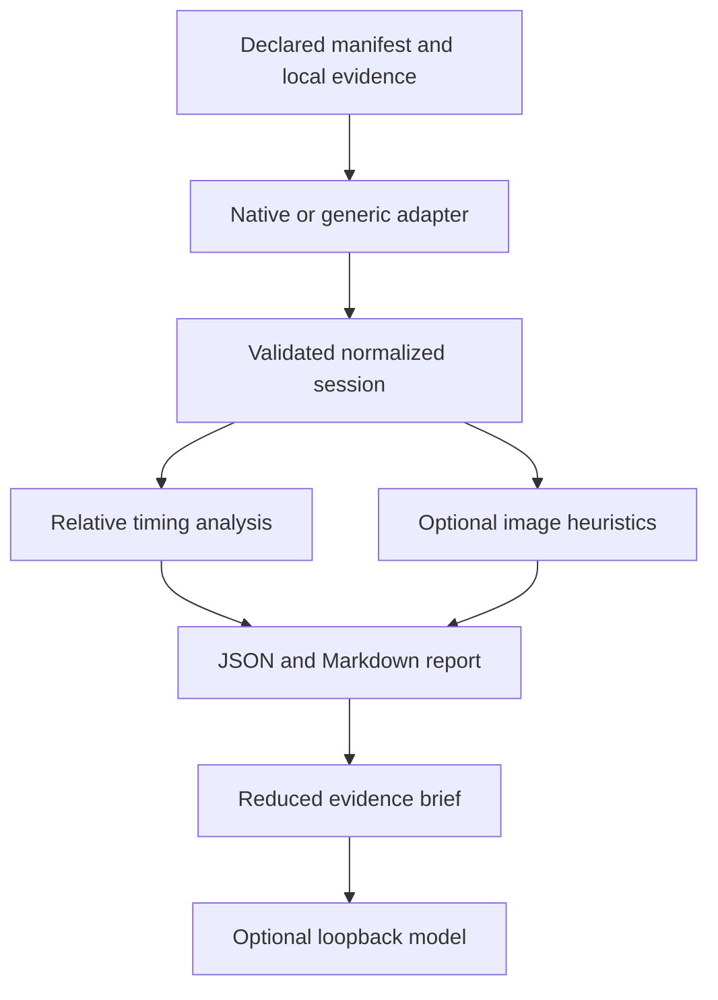

# Architecture

VGI (Visual Game Intelligence) is an offline diagnostic pipeline for explicitly supplied evidence. Its initial implementation was named Universal Recompilation Diagnostics (URD). The `vgi` entry point uses the existing `urd` core, and `python -m urd` remains a compatibility entry point. Normalized session and report schemas currently use version 1.

## Evidence flow

The `accept` command orchestrates collection, analysis, and local import/evidence checks; passing these checks does not establish real-game effectiveness. Collection is a separate explicit step that snapshots existing closed-session native files. It does not launch or modify the game. Pair comparison consumes two normalized sessions independently; it never joins their timestamps into a common timeline.

## Modules and responsibilities

| Module | Responsibility |
|---|---|
| `vgi`, `urd.__main__` | Public CLI and compatibility routing; explicit output destinations |
| `urd.collect` | Copy existing native metrics and optional log into a new session directory |
| `urd.adapters.bundle` | Read manifests, route adapters, load generic CSV/JSONL evidence, apply declared phase annotations |
| `urd.adapters.hookshot` | Strictly parse inspected native CSV schemas and preserve native timing/identity limitations |
| `urd.model` | Validate normalized records, constrain session-relative paths, and compute evidence hashes |
| `urd.analysis` | Detect local relative timing incidents and associate compatible evidence |
| `urd.visual` | Optional bounded adjacent-frame luminance heuristics using Pillow |
| `urd.sources` | Link supported metric evidence to pinned instrumentation emission locations |
| `urd.report` | Preserve evidence and limitations in deterministic JSON and Markdown, copying associated image bytes |
| `urd.compare` | Check declared cohort equivalence and report descriptive quantile differences |
| `urd.assistant` | Build reduced briefs and validate responses from an explicitly requested loopback model |
| `urd.fixtures` | Generate clearly labeled synthetic software-test data |

The implementation uses Python 3.10+ standard-library modules for its core. Pillow is optional and used only by image analysis. There is no database, daemon, overlay, remote inference integration, or game modification component.

## Normalized evidence

A manifest declares `schema_version`, `adapter`, `session_id`, an explicit boolean `synthetic`, and `metadata`, plus adapter-specific source paths. The normalized session contains frames, events, captures, warnings, and provenance. Frames carry increasing identities, monotonic local starts, positive finite durations, and optional phase/metric fields. Events and captures may have explicit identity, time, and uncertainty.

The importer validates timing consistency and rejects mixed synthetic markers, invalid numeric values, unsupported native headers, duplicate/reset identities, and unsafe paths. Session-relative paths resolve within the input directory, including after symlink resolution. These checks reduce accidental misuse; they do not provide process isolation or make arbitrary untrusted files safe.

Provenance includes SHA256 digests of input bytes and source references where available. A hash identifies bytes used by analysis. It does not attest that the recording is genuine or that declared metadata matches a real execution. Phase annotations and replay equivalence remain traceable user declarations.

## Time and identity boundaries

The Hookshot adapter is based on inspection of commit `e9975d6c245275aaf89a34e8d17a6bbe8badab46`. This is a schema research pin, not a runtime build check or support claim for every Hookshot release. See [instrumentation evidence](HOOKSHOT_INSTRUMENTATION.md) for primary source paths and line references.

| Evidence | Normalized interpretation | Boundary |
|---|---|---|
| `hookshot_frames.csv` | Same-row metric/frame identity; cumulative local timeline from rounded intervals | No absolute clock; uncertainty accumulates; first row is warmup |
| `RX_VK_FRAME_LOG` | Local elapsed presentation intervals with rounding uncertainty | Presentation is not GPU completion or scanout; counter differs from native game presents |
| `HOS_PRESENT_TRACE` | Preserved native presentation context | No automatic calibration to the primary trace |
| Ordinary text log | Source-referenced session context | No invented monotonic timestamps |
| Supplied image | Explicit compatible frame or clock identity | Filename and mtime never establish correspondence |

Exact frame association is preferred. Timestamp overlap requires a compatible declared monotonic domain. Uncertainty is retained in the association label, conflicting frame/time evidence is not joined, and unaligned records remain session context. Counter equality across domains is insufficient evidence.

## Analysis boundaries

Timing detection compares a sample with preceding continuous observations, using a median and robust dispersion over up to 60 samples after a minimum baseline of 12. It requires all relative, absolute, and dispersion thresholds, then freezes the baseline through a sustained incident. Phase exclusions and gaps reset the baseline. It detects relative degradation rather than an absolute performance target and can miss gradual or pre-baseline problems.

Image analysis converts bounded local image snapshots to a 16×9 luminance grid. It requires consecutive compatible frame identities and reports only low-confidence candidates. Black intervals need textured boundaries, repeated frames require declared expected motion, and global flashes remain ambiguous. It cannot establish visual correctness or reliably detect small and color-only defects.

Comparison requires known equal control conditions, matching declared replay coverage, and continuous gameplay cohorts of at least 30 samples. It computes interpolated p50/p95/p99 changes. Material-change thresholds are operational heuristics; statistical significance and causal attribution are never established by one pair.

Source correlations identify where inspected instrumentation emits a metric. They do not identify the defective source line. Optional model output is checked for bounded fields, allowed confidence, and valid evidence IDs, then marked untrusted. No suggestion is executed.

## I/O and privacy boundaries

- Import and analysis read only explicitly supplied local evidence. There is no disk scan, game launch, automatic capture, or telemetry.
- Collection requires the user to declare the game closed, checks source stability during copying, and writes only to a new output directory outside the input.
- Reports preserve input context and may copy associated capture bytes into an evidence directory. They are not automatically sanitized for public sharing.
- Reports use deterministic serialization for a given imported session and implementation. This does not imply deterministic gameplay or local model inference.
- `brief` is offline. `ai-local` explicitly makes an HTTP request to literal `127.0.0.1` only, without proxy lookup, DNS, or redirects. It sends a reduced brief; local server behavior remains outside VGI's control.
- Output guards prevent common evidence overwrites. Some failed operations may leave partial new outputs; select a fresh destination when retrying.

Binary frame-log ingest, cross-domain calibration, continuous capture, repeated-run inference, and validated real-game diagnostics remain pending. See the [roadmap](ROADMAP.md).
